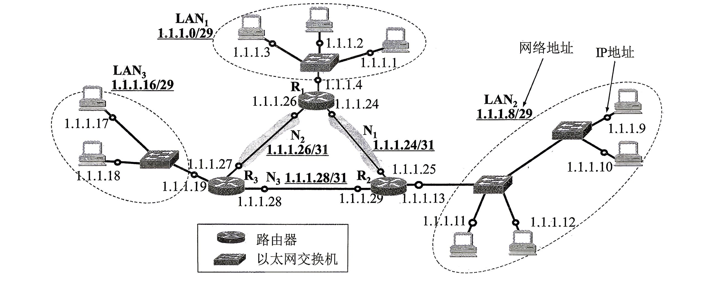
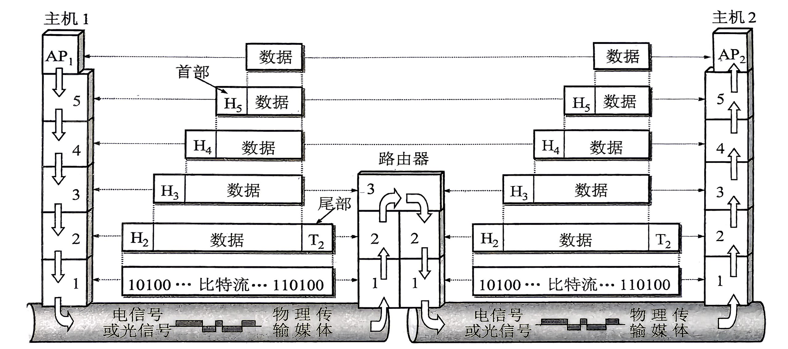

# 总体概述

计算机网络由若干个节点和连接这些节点的链路组成。网络把许多计算机连接在一起，而互联网则把许多网络通过一些路由器连接在一起，与网络相连的计算机常称为主机。

##  互联网组成

**互联网可以从工作方式上分为边缘部分和核心部分**

### 边缘部分

- 处在互联网边缘的部分就是连接在互联网上的主机，这些主机称为端系统
- 端系统之间的通信方式可以划分成两大类，客户-服务器方式（C/S方式）和对等方式（P2P方式）

### 核心部分

- 核心部分的主要作用是向边缘部分的主机提供连通性，当网络中的链路打通，连通性就实现了，数据可以在链路中传输。
- 数据传输有多种传输方式，网络中传输方式有多种分类
  - 面向有连接型与面向无连接型
    - 有连接型：在发送数据前，在收发主机之间连接一条通信线路，在通信结束后再释放连接
    - 无连接型：不要求建立连接和断开连接。发送端可在任何时候自由发送数据。
  - 电路交换与分组交换
    - 电路交换：在通话前必须先建立连接，建立连接（占用通信资源）-----通话（一直占用通信资源）-----释放连接（释放通信资源）
    - 分组交换：首先我们将要发送的整块数据称为一个报文，在发送报文前，先把较长的报文划分为一个个更小的等长数据段，每一个数据段在加上首部后称为分组，又叫做包。**路由器**则用来转发分组，路由器收到一个分组，先暂时存储下来，按照分组首部里的目的地址，找到合适的接口转发出去，把分组交给下一个路由器，这样一步步以存储转发的方式，把分组交付最终的目的主机。（相邻设备之间的一段连接称为链路，路由器可以看作节点，两个路由器之间的连接就是一条链路）。和电路交换不同的是，分组在哪段链路上传送才占用那段链路的通信资源。
      - 为了提高分组交换网的可靠性，互联网的核心部分常采用网状拓扑结构，使得当网络拥塞或少数节点，链路出现故障时，路由器可以灵活得改变转发路由（在网络层会讲到路由选择协议）
      - 由于分组在各路由器存储转发时需要排队，所以会造成一定的时延。
      - 分组携带的首部也会造成一定的开销
    - 报文交换：整个报文先传送到相邻节点，全部存储下来后查找转发表，转发到下一个节点。
  - 根据接收端数量分类
    - 单播
      - 就是一对一通信
    - 广播
      - 在一个广播范围内与这个范围内的所有主机通信
    - 多播
      - 多播和广播差不多，但是要在在一个范围内再限制一组主机进行通信

## 计算机网络的类别

### 按照网络的作用范围分类

- 广域网WAN
- 城域网MAN
- 局域网LAN
- 个人区域网PAN

### 按照网络的使用者进行分类

- 公用网
- 专用网

## 计算机网络的性能

- 速率
  - 即数据的传送速率，单位是bit/s
- 带宽
  - 在计算机网络中，常用来表示网络中某通道传送数据的能力时，即某信道所能通过的“最高数据率”，单位是bit/s
- 吞吐量
  - 表示在单位时间内通过某个网络的实际数据量
- 时延
  - 指数据从一端发送到另一段所需要的时间。分为发送时延（发送数据所需要的时间），传播时延，处理时延，排队时延（排队等待路由器处理的时间）
- 时延带宽积
  - 即传播时延✖️带宽
- 往返时间RTT
- 利用率
  - 分为信道利用率和网络利用率（全网络的信道利用率的加权平均值)
  - 如果信道利用率或者网络利用率过高就会产生非常大的时延

## 计算机网络体系结构

计算机网络的结构是分层次的，在网络中要做到可靠有效的交换数据，就必须遵守一些规则，这些规则规定了所交换的数据的格式以及有关的同步问题。这种规则在计网中被称为协议

### 分层的好处

1. 各层之间是独立的
2. 灵活性好
3. 易于实现和维护

### 具有五层协议的体系结构

### 下面简单介绍一下各层的作用

1. 应用层
   - 通过应用进程间的交互来完成特定网络应用，针对的是特定应用的协议。例如：电子邮件传输有电子邮件协议。
2. 运输层
   - 负责向两台主机中进程之间的通信提供通用的数据传输服务，运输层最主要的协议是TCP协议和UDP协议，其中TCP协议负责可靠传输。
3. 网络层
   - 负责为分组交换网上的不同主机提供通信服务。网络层把运输层产生的报文段封装成分组或包传送。
   - 负责地址管理与路由选择。
4. 数据链路层
   - 负责将网络层交下来的IP数据报组装成帧，在相邻两个节点间（路由器）的链路上传送帧
   - 负责互连设备之间传送和识别数据帧
5. 物理层
   - 在物理层上所传的数据的单位是比特，即0和1。物理层界定连接器和网线的规格。

## 用一个例子带你走进计算机网络工作原理

当你在浏览器输入我的博客链接sqbtt.cn

### 应用层

- 浏览器发现域名sqbtt.cn，先发起DNS查询（域名系统DNS），向DNS服务器发出请求，把域名解析成目标服务器的IP地址，在这里我们假设是1.1.1.9
- 然后发起http请求（请求访问页面资源），生成应用层数据，交由运输层

### 运输层

- 这里假设使用的是TCP协议，运输层收到应用层发下的数据后，加上TCP首部：源端口（80），目的端口（80）（http协议端口是80）等首部字段，封装成TCP段，交给网络层
- 运输层的端口用来标识某台主机的某个进程

### 网络层

- 加上IP首部（源ip，目的ip等），查路由表，确定下一跳，封装成IP数据报，交给数据链路层
- 主机的ip地址用来标识主机的地址，在这里我们可以区分，网络层实现了两台主机之间的通信，而运输层实现了两台主机里不同的通信进程之间的通信。
- 下面根据这张图来详细解释一下在网络层的传输细节

  

  这这张图片中，LAN1、LAN2、LAN3都是独立的网络（局域网），一个ip地址代表一台主机，一个圆圈内包含的主机表示这里的主机属于同一个网络。**如果要实现不同网络的通信，就需要路由器来传输数据到不同的网络**。

  在这里假设源主机ip为1.1.1.17，所以我们要实现从网络LAN3的1.1.1.17主机传输数据到网络LAN2的1.1.1.9。

  由于不同网络之间的主机无法直接通信，所以源主机要先把数据交给该网络内的路由器R3（该路由器也称为该网络的默认网关），然后该路由器通过路由选择协议，决定了下一跳是R2，再将数据交给目的主机所在网络的默认网关R2，最后目的主机所在网的默认网关再把数据传输给目的主机。

  这里有几个问题需要我们确定一下

  1. 在图上实现传播，有三段链路，第一段：1.1.1.17->1.1.1.19。第二段：1.1.1.28->1.1.1.29。第三段：1.1.1.13->1.1.1.9。注意在IP数据报中，目的ip必须始终是1.1.1.9，才不会丢失我们的目的地。那么在这三段链路的每一段链路中，我们设置目的地址不再是用ip地址，而是MAC地址。
  2. ip地址和MAC地址的区别：MAC地址是主机固定的物理地址，不会随着网络，位置等变化而变化，是出产就伴随的地址。而ip地址是分配下来的一个可以变化的地址，ip地址使用在网络层，MAC地址使用在数据链路层。
  3. 由上述可知，使用MAC地址的通信范围局限在一个网络内，那么为什么还需要ip地址呢？是因为不同网络里的主机的MAC地址可能不太一样，而ip地址是全地球统一的格式，所以可以跨网通信。每段以太网帧的目的 MAC 是**这一跳的下一跳**，跨路由器时会变；IP 分组的目的 IP 通常保持为最终目的地址。
  4. 但是我们只知道路由器的ip地址，我们怎么知道它的MAC地址呢？那就用到了ARP（地址解析协议），维护了ip地址->MAC地址的映射表。
  5. 可以知道数据链路层就是局限在一个网络里，实现每一段链路的通信。而网络层实现了不同网络之间的通信。
  6. 图中的以太网交换机的作用是实现**在一个网络内**不同主机之间的数据交换即通信

### 数据链路层

- 先查ARP（地址解析协议），根据下一跳IP，获取对应的MAC地址
- 加上帧头（源MAC，目的MAC）
- 封装成以太网帧交给物理层

### 物理层

- 把帧的二进制比特流，转换成电信号/光信号，在网线/光纤上传输。
- 最后，目的主机的物理层收到源主机发送过来的电信号/光信号，照物理层->数据链路层->网络层->运输层->应用层的顺序，在每一层去掉之前加的首部，最终在应用层获取到从源主机传输过来的数据

  
